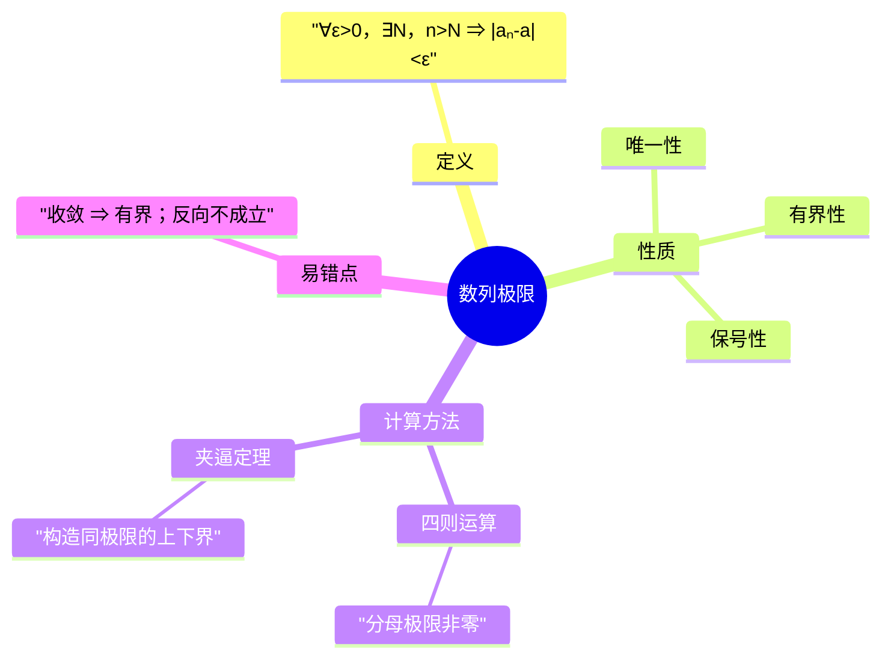
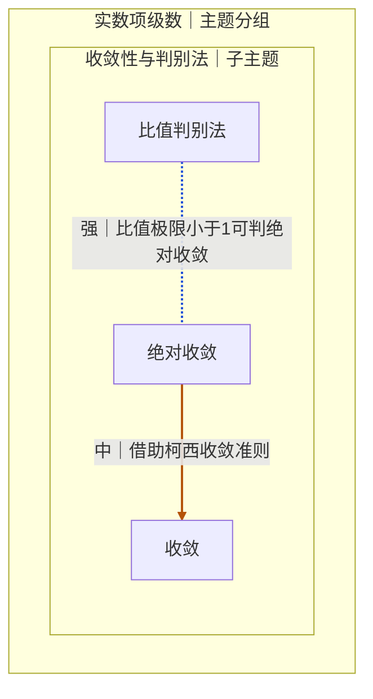

# 数学知识点思维导图

面向数学初学者与课程复习，先梳理知识逻辑，再生成可读的导图。遵循用户明确指定的范围、资料、详略和格式，不以形式整齐为由删减数学条件。

## 执行流程

1. 确认资料、主题范围、目标读者、交付格式和输出模式。用户未指定模式时采用标准模式；信息足够时直接执行，不反复追问。
2. 阅读资料并提取章节、概念、定理、公式、题型及其依赖，形成内部覆盖清单。
3. 根据输出模式、知识关系和资料规模选择树形、网络、分组框或嵌套圈，可在同一张图中组合。先确定每条连线的关系类型，再标注难度或关联强度；模式只控制呈现深度，不改变核验标准和资料范围。
4. 为需要图外补充的节点分配编号，将长条件、复杂公式和详细证明放在图后说明。
5. 渲染或检查图形语法，核对资料覆盖率、数学条件、关系箭头、颜色图例、嵌套含义和索引对应关系。
6. 交付导图，并简要说明整理范围、资料依据、拆图方式及待确认项。

## 三级输出模式

**默认：标准模式。** 支持“精简 / 标准 / 深入”三级模式，用户可明确指定，也可使用“速记版、简单梳理”“正常复习”“详细版、系统梳理”等自然语言表达。未指定时一律采用标准模式，不因资料较长而擅自切换深入模式；资料较长时可以增加必要分图以保持清晰。

1. **精简模式（快速预览、考前速记）**
   - 交付：一张简洁的核心知识导图；主题过大、单图无法清楚表达时允许拆成少量分图。
   - 内容：主要概念、关键定理与成立条件、核心公式、最重要的逻辑联系；仅补充理解必需的说明。
   - 省略：非必要的展开证明、大量例题、冗长方法对比；**不得省略导致结论失真的条件或量词**。
2. **标准模式（日常学习与课程复习，默认）**
   - 交付：简洁总览图 + 按需要提供分主题图 + 与图中编号对应的补充说明。
   - 内容：定义、定理及条件、核心公式、必要的知识联系、主要题型与方法，以及常见易错点；按实际内容选择，避免机械堆叠栏目。
   - 对复杂的推导或关系，可按需补充一张关系图或简短对比表；一般不展开完整证明，除非用户明确要求。
3. **深入模式（系统复习、深度理解与科研准备）**
   - 交付：多层级总览与分主题导图，配有图外详细说明；跨知识点依赖明显时增加关系图。
   - 内容：较完整的定义、条件与量词、定理间的依赖及证明关键思路、方法适用条件与典型题型、经核验的反例、易混概念对比；必要时补充公式解释和推导框架。
   - 完整证明、逐题详解或超出资料的内容仍遵循用户明确要求和资料范围限制，**不得因为选择深入模式就自动加入资料外知识**。

**模式选择与冲突处理：** 用户明确要求的详略、图数、文件格式优先于模式默认项；模式只决定组织密度与解释深度。即使精简模式，也必须先完成内部资料覆盖和数学正确性检查；精简的是展示，不是对指定重要知识的任意删减。仅有指定资料时，三个模式均以该资料为依据；只给主题时按声明的通用基础范围整理。用户要求仅更新某个分支时，沿用现有导图结构和已指定模式，仅调整相关内容。开头可简短注明所采用的模式，无需主动要求用户选模式。

## 资料与范围

1. 阅读用户提供的相关资料后再整理；优先沿用教材的章节、术语、记号和定义。仅处理用户指定页码、章节或主题，不擅自扩大范围。
2. 用户只给出明确主题时，按该主题的常见基础课程范围制作，简短说明所采用的范围。用户指定某份教材或笔记却未提供可访问内容时，请求必要材料；如先给通用框架，明确标注其并非该资料内容。
3. 图片和扫描资料中，关键符号、条件或章节不清楚时，标记“待确认”并请求对应部分，不猜测。能够可靠识别的部分继续整理。
4. 区分“资料原有内容”和有助理解的“补充联系”；补充内容单独标记。严格限定资料来源时，不加入资料外知识。保留可核实的章、节或页码线索，不编造出处。
5. 更新已有导图时先读取当前版本，识别新增内容应该归属的节点，保留原有正确内容；用户要求只修改某一部分时，仅修改该范围。原导图不可访问时请求提供，不凭记忆声称已修改。

## 知识组织

1. 先识别中心主题、章节主线与学习目标。按知识对象或主题建立一级分支，保持同层节点粒度相近；不要把所有章节强行放进一个巨大图中。
2. 在相关主题下按需组织以下内容，而不是给每个分支机械复制空栏目：
   - 定义与记号：概念的准确含义、对象和关键量词。
   - 定理与性质：前提条件、结论和适用范围；区分定义、已证明性质与推论。
   - 核心公式：含义、变量与使用条件。
   - 典型题型与方法：题目线索 → 方法选择 → 核心步骤 → 验算或条件检查。
   - 易错点与反例：容易混淆的概念、错误逆命题和必要条件。
3. **标准模式**默认采用概览加分主题导图，层级约 3–4 层；精简模式优先一张简洁导图，深入模式可增加分图和图外关系说明。各模式均以完整表达为准，必要时拆图，避免为了控制层级而遗漏条件。每个节点以短语为主，长公式、详细证明与大段解释移到图后的补充说明。
4. 仅为包含图外补充内容的节点编号，按 N1、N2……连续编号；每个编号在当前交付中唯一，并在图后按相同顺序给出完整说明。不得用编号替代理解定理所必需的核心前提，不得出现跳号、重复编号或无法对应的说明。
5. 整理“怎么求”“怎么判断”“怎么证明”时，按任务类型串联可选方法，说明各方法适用条件。不要只罗列定理名称；仅纳入当前课程涉及的方法。
6. 增加必要的跨分支联系：标注“推出”“等价”“特例”“依赖”“方法适用”等关系。优先在主图中清晰表达；跨线太多时，再用小关系图或关系表补充。树枝、分组边界和一般关联线只说明分类、范围或联系，不表示逻辑蕴含。

## 数学准确性

- 核对定义的环境和约定，例如实数域/复数域、有限维/无限维、度量/一般拓扑、处处/几乎处处。
- 在定理节点或紧邻说明保留必要条件；不把充分条件写成充要条件，不无条件倒转推论。
- 为关系箭头标明成立条件。例如“闭且有界 ⇒ 紧”应注明欧氏空间或有限维赋范空间，不推广到任意度量空间。
- 区分逐点与一致收敛、独立与不相关等易混概念；优先用紧凑比较或一个经过核验的反例说明差别。
- 证明只保留关键思路和依赖，用户要求时才展开。若需要证明多个条件等价，优先按 1→2→3→1 构成闭环，避免循环引用。
- 资料中有明显错误时指出具体条件或推导问题，提供有依据的更正；无法确认时标记疑问，不把错误结论纳入正式导图。

## 连线编码：推导难度与关联强度

对有数学意义的框间连线分类标注。颜色用在线条或箭头上，配短标签和线型，使黑白打印和不支持颜色的界面也能读懂。每张图只列出实际使用的图例项；同一图中同一颜色含义保持一致。

| 关系类型 | 连线形式 | 颜色与标签 | 判定依据 |
|---|---|---|---|
| 推导、蕴含 | 实线单向箭头 | 绿 `#15803D`：易；橙 `#B45309`：中；红 `#B91C1C`：难 | 易：直接用定义或一步运算；中：需要若干步骤或借助已学定理；难：需要新引理、多个关键步骤或明显较强的先修知识 |
| 等价 | 实线双向箭头，或两条单向箭头 | 同上；两个方向难度不同时分别标注 | 分别检查两向的前提和难度，不用单向结果代替等价 |
| 知识关联、方法用途、对比 | 无箭头虚线，短标签写明关系 | 深蓝 `#1D4ED8`：强；紫 `#7E22CE`：中；蓝灰 `#64748B`：弱 | 强：直接用于判定、求解或理解另一知识点；中：共享核心方法、结构或适用场景；弱：仅有值得提示的类比或背景联系 |
| 分类、包含、难度或强度无法判断 | 分组边界或中性连线 | 灰 `#6B7280`，按需标注“分类”“包含”或“待判定” | 仅同属一章不能当作强关联；资料不足时不随意评级 |

- 推导箭头从前提指向结论；写“易/中/难｜关系或关键依据”，成立条件放在箭头标签或相邻节点。难度按用户的学习阶段和图中实际采用的推导路线判断，不以定理名气或结论长短判断。
- 关联线写“强/中/弱｜关联理由”。“强关联”并不意味着能推出对方；没有复习价值的弱关联可以省略。
- 同一对节点若还要同时显示难度和关联强度，颜色表示该条线的主要含义，另一项可用短标签补充，例如“推导：中｜关联：强”。只在两项都有依据且有帮助时这样标注，避免叠加两条难分辨的线。
- 颜色、线型和文字至少保留两种可用线索；无法控制颜色时，用“推导：易/中/难”“关联：强/中/弱”等文字标签保留完整信息，不假称已经着色。

## 布局选择：树形、网络与嵌套

- **树形**：适合章节提纲和单一分类；跨分支关系少时使用。
- **关系网络或流程图**：适合多个概念互相联系、并列方法比较或多步推导。使用可区分方向和线型的连接，避免让分叉都看起来是推出。
- **嵌套圈或分组框**：适合表示范围包含、对象层级或主题中的子主题。外圈是较大的集合、适用范围或主题，内圈是其中的子集、特殊情形或子主题；标注这是“集合包含”还是“主题分组”。只有确实存在交集且材料支持时才用相交圈；并列主题用并排分组。圈或框的套叠不代表逻辑推导，推导仍另画箭头。
- 可以将同主题节点放在一个嵌套分组中，再用跨组连线表达推导或关联。优先选能清楚表达本题的布局；用户指定样式时优先遵循。若对话渲染器不支持真正的嵌套圆形，使用 Mermaid flowchart 的嵌套 subgraph 分组框，或在用户需要圆形时提供可渲染的 SVG 等可用格式。不要把单个圆形节点当成可容纳其他节点的嵌套圈。

## 可视化与公式

1. 默认在对话中展示可渲染的导图。纯层级用 Mermaid mindmap；需要独立着色的连线、交叉关系或嵌套分组时，优先用 Mermaid flowchart 或可用的确定性矢量渲染。遵循当前界面支持的语法：用实线箭头表示推导、无箭头虚线表示关联；采用按边顺序的 linkStyle 时，编辑后重新核对边序号与颜色。不要仅给平铺的文字清单却称作思维导图，也不要默认只交代码文件。
2. 标准及深入模式下，大范围主题采用一张简洁总览加若干分图；精简模式优先展示核心总览，确有必要时拆图。遵守当前界面的图形尺寸约束，分支过多时按章或主题分拆；优先阅读清晰，避免将整门课程压成一张缩小后无法阅读的图。
3. 使用简短中文标签，按 Mermaid 当前语法要求处理含括号或标点的复杂标签；不使用 HTML 标签、点击指令或图内配置。条件较长时在节点写“条件见 N1”等明确索引，在紧邻的说明中完整列出，不静默删除条件。
4. 节点内使用简单 Unicode 数学符号，如 Σ、∈、≤、⇒、E(X)，避免嵌入复杂 LaTeX。图外公式采用简单行内或独立公式排版，避免使用 boxed、aligned 等容易影响手机端显示的命令或复杂嵌套环境。
5. 用户要求 PDF、图片、Word 等文件时，使用相应可用的文件制作能力和适用技能；采用可搜索的文字与矢量绘制等确定性方法生成精确数学导图，不用生成式图片工具绘制公式。检查中文字体、公式、分页、裁切和缩放后的可读性，再交付。没有相应导出能力时如实说明并给可用格式，不假称已生成文件。
6. 节点和分组背景默认清爽、低饱和，可用柔和粉色强调重点；连线颜色保留给图例定义的难度和关联强度。检查线条与背景的对比，不用节点颜色代替连线标注。

## 交付规范

1. 默认采用**标准模式**，交付“范围及模式说明 + 合适布局的总览图（含必要图例） + 必要分图 + 图后补充说明”；精简与深入模式依照“三级输出模式”调整深度。随后按需给出精简的知识联系、易错点或方法索引，避免重复全部节点。
2. 用户要求源文件时，同时提供可编辑的 `.md` 或 `.mmd` 内容；用户指定其他格式时优先遵循其要求。
3. 存在待确认内容时，在交付末尾集中列出对应节点和需要补充的资料，不让疑问散落在图中而缺少说明。
4. 开头用一两句话说明整理范围和资料依据；局部更新时说明新增或修正的位置，交付更新后的指定内容或文件。
5. 无法实际渲染时，明确区分“文本语法检查”与“视觉预览验证”，不把前者声称为后者。

## 输出示例

以下示例仅说明布局和标注方式，不要求所有主题机械包含相同栏目。只有层级关系时可以用树形：



需要展开图外内容时，在对应节点标注“见 N1”，并在图后写：

```markdown
**N1｜夹逼定理**：若从某项起有 bₙ ≤ aₙ ≤ cₙ，且 bₙ 与 cₙ 收敛到同一极限 L，则 aₙ 也收敛到 L。
```

当主题同时包含范围、推导和方法关联时，可用嵌套分组框与带色连线：



图例：橙色实线箭头＝中等难度的推导；深蓝色无箭头虚线＝强关联。外框与内框在这个例子里表示主题与子主题，不是集合包含。

## 交付前检查

- 检查输出模式是否符合用户要求（未指定则为标准模式），且模式调整没有改变资料范围或降低数学准确性。
- 对照资料检查指定章节有无遗漏，概念、定理与方法是否混淆，条件和量词是否完整。
- 检查关系箭头是否成立，补充内容是否标明，资料线索是否真实可核实。核对线色、线型与图例一致，推导难度和关联强度没有混读，双向难度不同已分开，嵌套或相交确有依据。
- 检查每个节点编号是否有唯一对应说明，每个图后编号是否都在图中被引用。
- 检查图形语法、拆分方式与实际可读性；具备渲染工具时预览并修正。
- 没有运行过的测试、没有访问过的资料和没有生成的文件均不得声称已完成。

## 验收测试

开发和修改本 Skill 后，至少使用以下场景测试，并依据“交付前检查”验收：

1. 仅输入“帮我整理数列极限思维导图”：应按通用基础范围直接生成，不虚构教材依据。
2. 输入指定教材页码或笔记片段：应限定范围、保留资料线索，并将资料外补充单独标记。
3. 输入内容较多的一整章：应生成总览和必要分图，而不是一张难以阅读的大图。
4. 要求在已有导图中补充一个定理：应先读取原图，仅更新相关分支并说明修改位置。
5. 输入“精简模式整理某章”：应突出核心节点，尽量用单图表达，同时保留关键条件，不把未讲到的资料外结论加入图中。
6. 未指定模式输入“整理一章思维导图”：应选择标准模式，有概览及必要分图、方法和易错点，而非自动进入深入模式。
7. 输入“深入模式，严格按照上传的讲义”：应增加讲义内的依赖、方法与关键证明思路，不越界补充未在讲义出现的定理。
8. 输入“区分推导难度和知识点关联，画实数项级数的分组图”：检查两类连线有独立的颜色体系和文字提示，改为黑白仍可区分；存在包含或主题分组时用嵌套表示，不能误读为推导。
9. 输入“画出绝对收敛、条件收敛与收敛的范围”：优先使用两个并列内圈或内框，放在“收敛”外圈或外框中，且两内区互斥；没有证据的相交与推导箭头不得加入。
